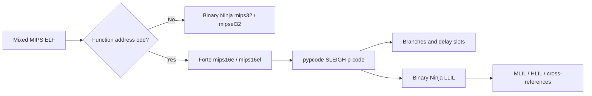

# Forte

**MIPS16e support for Binary Ninja—mixed-mode ELF routing, disassembly, and LLIL.**

[](https://github.com/ruizkinio/forte-binja/actions/workflows/ci.yml)
[](LICENSE)
[](https://binary.ninja/)
[](https://www.python.org/)

Forte fills a practical gap in firmware analysis: Binary Ninja's MIPS
architecture does not currently decode MIPS16e, so compressed functions can
appear as invalid or misleading MIPS32 instructions. Forte adds separate
big- and little-endian MIPS16e architectures and connects them to the normal
MIPS32 architectures for mixed-mode ELF files.

Forte runs entirely inside Binary Ninja. It uses
[pypcode](https://github.com/angr/pypcode) as its SLEIGH decoding engine; it
does not launch Ghidra or any external disassembler.

## What works

- Big-endian `mips16e` and little-endian `mips16el` architectures
- 16-bit and extended 32-bit MIPS16e instructions
- Odd-address ELF mode tags, canonicalized to even instruction addresses
- MIPS32 ↔ MIPS16e mixed-mode architecture routing
- Direct, conditional, indirect, call, and return control-flow metadata
- Delay slots lifted exactly once
- Linux o32 argument, return, saved-register, stack, and global-pointer rules
- Common integer, memory, pointer, control-flow, and floating-point p-code
  lifted to Binary Ninja LLIL
- Built-in self-test, existing-database seeding, and LLIL coverage report

## Quick start

### Install manually

Clone the repository into Binary Ninja's user plugin directory:

```bash
# macOS
git clone https://github.com/ruizkinio/forte-binja \
  "$HOME/Library/Application Support/Binary Ninja/plugins/forte-binja"

# Linux
git clone https://github.com/ruizkinio/forte-binja \
  "$HOME/.binaryninja/plugins/forte-binja"
```

On Windows, clone into:

```text
%APPDATA%\Binary Ninja\plugins\forte-binja
```

Binary Ninja reads `requirements.txt` and installs `pypcode`. Restart Binary
Ninja after installation.

### Analyze a mixed-mode ELF

For the cleanest result:

1. Install Forte and restart Binary Ninja.
2. Open the original ELF in a new analysis database.
3. Forte routes odd function-symbol addresses to MIPS16e automatically.
4. Use **Tools → Forte → Report LLIL Coverage** to inspect lifting coverage.

For an ELF already open in a `.bndb`, use:

- **Tools → Forte → Seed Functions from Odd ELF Symbols**
- **Forte → Analyze MIPS16e Function Here** from an address context menu

Forte does not delete or overwrite existing functions when seeding an old
database.

## Why odd addresses matter

MIPS ELF toolchains commonly store a MIPS16 function symbol as
`real_address | 1`. The low bit selects compressed ISA mode; it is not part of
the byte address.

```text
ELF function symbol: 0x00401c95
Instruction address: 0x00401c94
Architecture:        mips16e
```

Forte hooks Binary Ninja's `mips32` and `mipsel32` address association so the
mode tag selects the correct architecture while analysis continues at the
canonical even address.

## Architecture



The decoder is intentionally independent of Binary Ninja. CI can validate
endianness, instruction lengths, branch targets, and delay-slot handling
without shipping a Binary Ninja license or proprietary firmware.

## Validation

Run the standalone test suite:

```bash
python -m pip install -r requirements-dev.txt -r requirements.txt
pytest
ruff check .
```

Inside Binary Ninja, use **Tools → Forte → Run Decoder Self-Test**. The
coverage command reports every p-code opcode encountered in Forte functions
and clearly identifies operations that still fall back to unimplemented LLIL.

No firmware image, vendor binary, credential, or Binary Ninja database is
included in this repository.

## Status and limitations

Forte is an alpha architecture plugin. It is already useful for control-flow
recovery and common firmware code, but it is not yet a proof of complete
MIPS16e ISA or LLIL coverage.

- Uncommon SLEIGH operations may emit `LLIL_UNIMPL`.
- DSP, coprocessor, and unusual floating-point behavior need more fixtures.
- Existing databases may retain incorrect functions created before Forte was
  installed; reopening the original ELF gives the cleanest analysis.
- The first release targets 32-bit MIPS16e. MIPS16e2 and vendor extensions
  need separate validation.

Please attach a minimal redistributable byte sequence—not copyrighted
firmware—to bug reports whenever possible.

## Roadmap

- Expand verified p-code-to-LLIL coverage
- Add corpus tests from freely redistributable MIPS16e binaries
- Improve mode transitions through indirect calls
- Add architecture patching and assembly support
- Submit Forte to Binary Ninja's community plugin repository

## Contributing

Focused fixtures, lifter corrections, and mixed-mode ELF reports are welcome.
See [CONTRIBUTING.md](CONTRIBUTING.md) and the
[security policy](SECURITY.md).

## License

Forte is available under the [MIT License](LICENSE).
